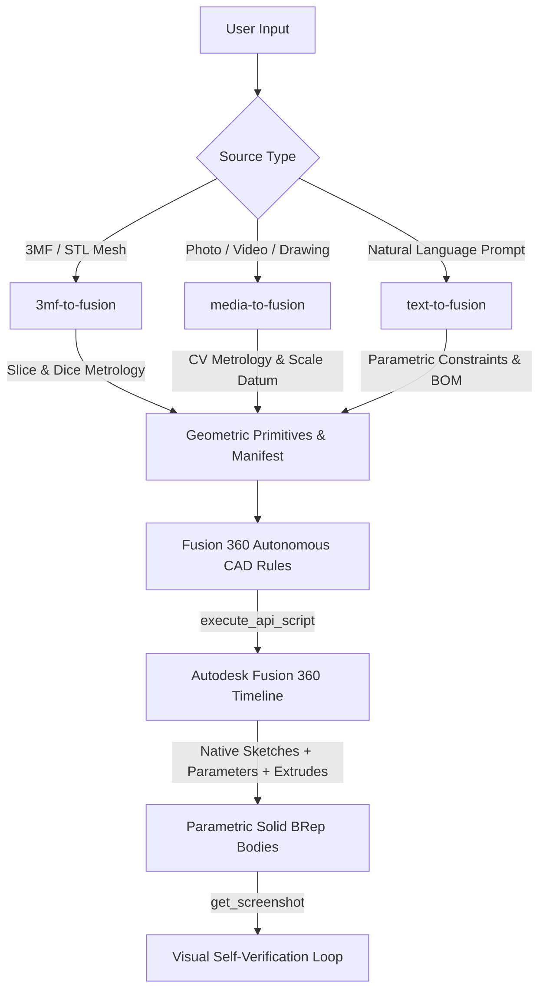

# To-Fusion-Skill-Sets

[](https://www.python.org/downloads/)
[](https://www.autodesk.com/products/fusion-360)
[]()
[]()
[](LICENSE)

Autonomous **Autodesk Fusion 360** parametric CAD engineering skills and rulesets designed for AI coding agents (**Google Antigravity**, **Anthropic Claude Code / Claude Desktop**, **Cursor / Windsurf**).

---

## ⚡ Overview

Instead of treating CAD as naive mesh dumps or raw STL conversions, `To-Fusion-Skill-Sets` empowers AI agents to operate as deterministic mechanical engineers. The skills dissect meshes mathematically, extract geometric primitives, calibrate real-world scale from photos/videos, enforce physical kinematic laws, and synthesize **100% native, parametric, timeline-editable solid models** in Autodesk Fusion 360 via the Fusion 360 MCP server (`fusion-mcp`).



---

## 📦 The Skill Suite

### 1. [`skills/3mf-to-fusion`](skills/3mf-to-fusion)
*Advanced CAD Reverse-Engineering Engine for `.3mf` and `.stl` files.*
- **Mandate:** Strictly avoids `bRepBodies.addByMesh` / `MeshToBREP`. Reconstructs editable solid timeline features.
- **Slice & Dice Metrology (`inspect_3mf.py`):** Multi-axis mesh slicing, tier detection, and archetype classification (Prismatic, Axisymmetric/Turned, Shell Enclosures, or Organic Sculptures).
- **Chord Error Compensation:** Uses 95th-percentile circumscribed circle radii to counteract polygon edge chords from mesh tessellation.
- **Primitive Recognition:** Automatically identifies obround/stadium slots, captive hex pockets, and grid pattern arrays.

### 2. [`skills/media-to-fusion`](skills/media-to-fusion)
*Computer Vision Metrology & Kinematic Synthesis from Photos, Drawings, and Videos.*
- **Computer Vision Engine (`process_media.py`):** Extracts keyframes, generates calibrated dual-contrast pixel grids (100px major / 50px minor), detects Canny contours, and handles split orthographic viewports.
- **Multi-Tier Scale Calibration ("Golden Datum"):** Calibrates real-world millimeters from IKEA Skådis patterns (40mm pitch, 5x15mm slots), DIN fasteners, USB-C openings, or ergonomic datums.
- **Kinematic Synthesis:** Enforces physical linkage equations (such as Coplanar Echelon Multi-Pin Parallelograms for multi-tier cantilever organizers) over perspective distortion.

### 3. [`skills/text-to-fusion`](skills/text-to-fusion)
*Natural Language to Pure Parametric CAD Assemblies & Fastener BOMs.*
- **Parametric Scaffolding (`scaffold_text_model.py`):** Formalizes conversational requests into bounded envelopes ($W \times D \times H$), wall thickness constraints, and driving user parameters.
- **Standardized Fasteners:** Synthesizes parametric DIN 7991 M3 countersunk screws, captive DIN 934 M3 hex pockets, and retaining washers.
- **Showroom Variant Pattern:** Stages experimental design options non-destructively in an isolated component without breaking timeline dependencies.
- **High-Speed Animation:** Animates kinematic mechanisms and exploded views via direct `Occurrence.transform` Matrix3D updates.

### 4. [`skills/to-fusion-animate`](skills/to-fusion-animate)
*High-Speed Assembly Animation & Dynamic Kinematic Verification.*
- **Zero Timeline Bloat:** Animates assemblies using direct 4x4 affine scene-graph transforms (`Occurrence.transform`) running at `0.005 s/update`.
- **Ephemeral 3D Collision Sweep:** Runs intermediate 3D BRep interference checks ($s \in \{0.0, 0.25, 0.5, 0.75, 1.0\}$) inside an ephemeral `Kinematic_Stage` to detect mid-stroke collisions.
- **Dual-Path GIF89a Compiler:** Compresses looping GIFs with Pillow (Lanczos/Floyd-Steinberg) or zero-dependency Windows PowerShell .NET fallback.

### 5. [`skills/to-fusion-sync`](skills/to-fusion-sync) & [`to-fusion-dev-sync`](skills/to-fusion-dev-sync)
*Universal Repository & Agent Runtime Synchronization Across Workstations.*
- Verifies branch parity, stages WIP changes, hot-links unreleased skills into Antigravity (`~/.gemini/antigravity/skills/`) and Claude Code (`~/.claude/skills/`), and generates handoff receipts.

---

## 🧩 Shared CAD Kernel & In-Place Editing Suite

To avoid prompt bloat, universal geometry algorithms, hardware specifications, and surgical editing tools are implemented as tested Python modules:

- **`shared/` Kernel:**
  - `cad_primitives.py`: Unit conversions (`cm`/`mm`), regular polygon/hex generator, driving parameter bindings.
  - `hardware_library.py`: Parametric DIN 7991 M3 flat head countersunk screws, DIN 934 hex nuts, Maker's Supply M3 joint stackups.
  - `scene_animator.py`: $SE(3)$ planar pivot matrix transforms (`make_yz_transform`), multi-frame 3D interference sweeps (`check_stage_interference`), dual-path ping-pong GIF compiler.
  - `fusion_client.py`: Resilient Fusion MCP API caller and screenshot wrapper.
- **`tools/fusion_editor/` (In-Place Surgical Editing):**
  - `inspect_model.py`: Live introspection of active design tree, parameters, timeline health, and planar faces.
  - `edit_parameter.py`: Tier 1 instantaneous parameter adjustments with zero timeline clutter and automatic rollback on failure.
  - `rollback_edit.py`: Tier 2 safe timeline marker rollback for upstream sketch/feature redefinition.
  - `append_feature.py`: Tier 3 downstream pocket/hole/chamfer feature appending without full rebuilds.
  - `timeline_doctor.py`: Traverses timeline health states (`Healthy`, `Warning`, `Error`) with actionable diagnostic traces.

---

## 📜 Engineering Rulesets

The repository includes ready-to-use engineering rulesets ensuring AI agents adhere to CAD best practices:

| Ruleset File | Platform | Purpose |
| :--- | :--- | :--- |
| [`rules/fusion-autonomous-cad-rules.md`](rules/fusion-autonomous-cad-rules.md) | Universal | Core engineering rules: centimeters vs mm, canary probes, visual verification, timeline hygiene. |
| [`rules/model-isolation-rules.md`](rules/model-isolation-rules.md) | Universal | Project workspace cleanliness rules and directory isolation standards (`models/<NN>_<Model_Name>/`). |
| [`rules/CLAUDE.md`](rules/CLAUDE.md) | Claude Code / Claude Desktop | Drop-in rule configuration for Anthropic Claude agents. |
| [`rules/GEMINI.md`](rules/GEMINI.md) | Google Antigravity | Drop-in rule configuration for Google Antigravity / Gemini CLI (`~/.gemini/GEMINI.md`). |
| [`rules/CURSOR_RULES.md`](rules/CURSOR_RULES.md) | Cursor / Windsurf | Drop-in rule configuration for Cursor (`.cursorrules`). |

### Key Rule Highlights:
1. **Centimeter API standard:** Fusion 360's internal C++ core strictly uses **centimeters (`cm`)**. All millimeter values MUST be divided by 10 (`val / 10.0`).
2. **Pre-Flight Canary Probe:** Probe `Application.get()` and `Design.cast(app.activeProduct)` before running extraction or modeling scripts to fail fast if Fusion 360 is closed.
3. **Component Occurrence Isolation:** Every distinct part must be wrapped in its own `root.occurrences.addNewComponent(transform)`.
4. **Visual Self-Verification Loop:** Geometry is never accepted based on exit codes alone; every change triggers a `get_screenshot` (`iso-top-right`) visual inspection.

---

## 🚀 Quickstart & Installation

### Option 1: One-Click Installer (`setup.sh`)
Clone the repository and run the setup script:
```bash
git clone https://github.com/your-username/To-Fusion-Skill-Sets.git
cd To-Fusion-Skill-Sets
./setup.sh
```
The script will:
- Verify Python $\ge 3.10$.
- Create a virtual environment (`.venv`) and install dependencies from `requirements.txt`.
- Detect **Antigravity** and offer to symlink skills into `~/.gemini/antigravity/skills/`.
- Detect **Claude** and offer to install skills globally into `~/.claude/skills/`.

---

### Option 2: Setup for Google Antigravity (AGY)
To link these skills directly to your local Antigravity installation:
```bash
bash tools/sync_local.sh
```
To enable global rules in Antigravity, append [`rules/GEMINI.md`](rules/GEMINI.md) to your `~/.gemini/GEMINI.md`:
```bash
cat rules/GEMINI.md >> ~/.gemini/GEMINI.md
```

---

### Option 3: Setup for Anthropic Claude Code & Claude Desktop

#### 1. Claude Code
Install skills globally for Claude Code:
```bash
python3 tools/export_for_claude.py --global-claude
```
Or set up for a specific project folder:
```bash
python3 tools/export_for_claude.py --claude-code /path/to/cad-project
```

#### 2. Claude Desktop
To connect Claude Desktop to Autodesk Fusion 360, add the `fusion-mcp` server to your `claude_desktop_config.json`:
```json
{
  "mcpServers": {
    "fusion-mcp": {
      "command": "python3",
      "args": ["/Users/<username>/.gemini/antigravity/mcp/fusion-mcp/server.py"],
      "env": {
        "FUSION_API_PORT": "12345"
      }
    }
  }
}
```
*(Run `python3 tools/export_for_claude.py --mcp-config` to generate your exact config snippet).*

---

## 📝 Change Logging & Version Tracking

All modifications, enhancements, and bug fixes to skills are systematically tracked in [CHANGELOG.md](CHANGELOG.md) and [`skills_manifest.json`](skills_manifest.json).

### Recording a Skill Modification:
Whenever you or an agent modifies a skill, record it with the included logger:
```bash
# Add a new feature:
python3 tools/log_change.py --skill 3mf-to-fusion --type added --message "Added chord error compensation for hex pockets"

# Record a bug fix:
python3 tools/log_change.py --skill media-to-fusion --type fixed --message "Fixed skew in split-viewport orthographic Canny detection"
```

### Releasing a New Version:
To finalize all unreleased changes into a tagged version:
```bash
python3 tools/log_change.py --release 1.1.0
git commit -am "chore(release): bump version to 1.1.0"
git tag v1.1.0
```

---

## 📂 Repository Architecture

```text
To-Fusion-Skill-Sets/
├── README.md                           # Main documentation & architecture guide
├── CHANGELOG.md                        # Semantic version change history
├── CONTRIBUTING.md                     # Contribution & skill development guidelines
├── LICENSE                             # MIT Open Source License
├── pyproject.toml                      # Modern Python build declaration (pip/uv)
├── requirements.txt                    # Python dependencies
├── setup.sh                            # One-click installer for Antigravity & Claude
├── skills_manifest.json                # Machine-readable registry of skills & dependencies
├── rules/                              # Engineering rulesets & agent configs
│   ├── fusion-autonomous-cad-rules.md  # Core CAD engineering standards
│   ├── model-isolation-rules.md        # Workspace hygiene & directory isolation
│   ├── CLAUDE.md                       # Drop-in rules for Claude Code
│   ├── GEMINI.md                       # Drop-in rules for Antigravity
│   └── CURSOR_RULES.md                 # Drop-in rules for Cursor / Windsurf
├── shared/                             # Reusable CAD kernel & animation helpers
│   ├── cad_primitives.py               # Unit conversions & geometric helpers
│   ├── hardware_library.py             # Standardized fasteners & joint stack-ups
│   ├── scene_animator.py               # High-speed transforms & GIF compiler
│   └── fusion_client.py                # Fusion MCP execution wrapper
├── skills/                             # The core agent skills
│   ├── 3mf-to-fusion/                  # Mesh reverse-engineering skill
│   │   ├── SKILL.md
│   │   ├── references/
│   │   └── scripts/ (inspect_3mf, section_pack, conical_pip_calc)
│   ├── media-to-fusion/                # Computer vision metrology skill
│   │   ├── SKILL.md
│   │   ├── references/
│   │   └── scripts/process_media.py
│   ├── text-to-fusion/                 # Natural language CAD synthesis skill
│   │   ├── SKILL.md
│   │   ├── references/
│   │   └── scripts/scaffold_text_model.py
│   ├── to-fusion-animate/              # Assembly animation & kinematics skill
│   │   ├── SKILL.md
│   │   ├── references/
│   │   └── scripts/animate_assembly.py
│   ├── to-fusion-sync/                 # Cross-machine workstation sync skill
│   └── to-fusion-dev-sync/             # Developer WIP & beta skills sync skill
├── tests/                              # Automated test suites
│   ├── test_fusion_editor.py
│   ├── test_shared.py
│   └── test_sync_manager.py
├── tools/                              # Automation & maintenance tools
│   ├── fusion_editor/                  # Surgical in-place timeline editing tools
│   ├── export_for_claude.py            # Claude Code / Claude Desktop exporter
│   ├── log_change.py                   # Skill change audit & version bump CLI
│   ├── scaffold_model.py               # CAD-ICM model folder generator
│   └── sync_manager.py                 # Cross-platform live linking engine
└── .github/
    └── workflows/
        └── lint_and_test.yml           # Automated syntax & manifest validation CI
```

---

## 🤝 Contributing

Contributions are welcome! Please read [CONTRIBUTING.md](CONTRIBUTING.md) for instructions on adding new skills, writing reference patterns, and following our change-logging conventions.

---

## 📄 License

This project is licensed under the [MIT License](LICENSE).
