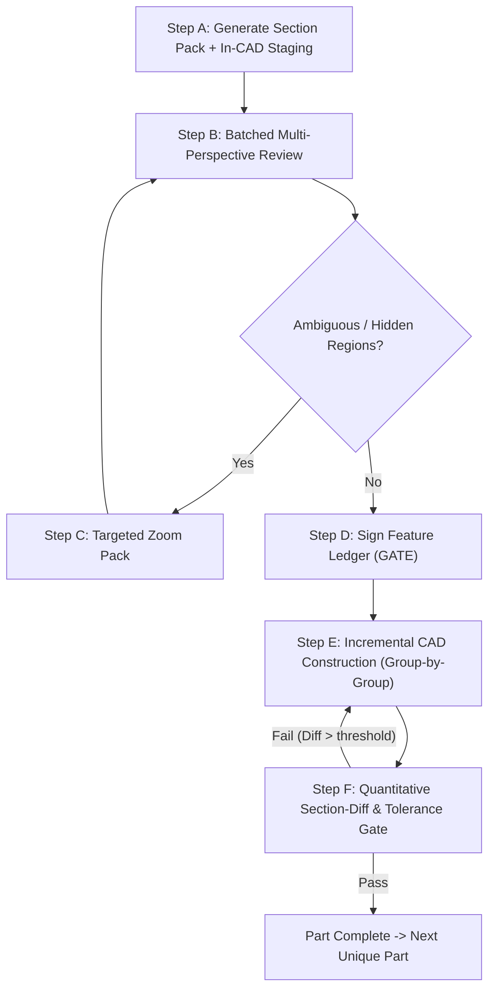

# 3MF / STL to Fusion 360 Analytical Reverse-Engineering Skill

When asked to copy, reverse-engineer, or recreate a `.3mf` or `.stl` file in Autodesk Fusion 360, follow this deterministic, evidence-first analytical pipeline.

---

## THE ANTI-PATTERNS (What Was Done Wrong in Past Reconstructions)

Before executing any commands, internalize these fatal anti-patterns to prevent repeating past failures:

1. **Monolithic Bulk Synthesis (Anti-Pattern)**:
   Attempting to construct all components or an entire complex part simultaneously inside a single script. This invariably causes nuanced mechanical features (continuous 45° knife-edge/dovetail rails, stepped lateral margins, rounded obround slot terminations, and pin offsets) to be oversimplified into basic rectangular cutouts.
2. **Distant Viewport Telemetry**:
   Capturing camera screenshots showing all components lined up across the entire build plate. At that distance, sub-millimeter features (such as $\varnothing 2.0\times 0.8\text{ mm}$ guide pins, $1.0\text{ mm}$ slot depths, and $45^\circ$ rail chamfers) render as only 2–3 pixels, making visual inspection and defect detection impossible before coding.
3. **Premature Completion Claims**:
   Declaring geometry "complete" before conducting close-up, isolated raw mesh metrology, section-by-section multi-axis verification, and quantitative mesh-diff comparisons.

---

## THE CAD REVERSE-ENGINEERING MANDATES

### Mandate 1: Strictly Forbidden — Convert Mesh to Solid (`MeshToBREP` / `bRepBodies.addByMesh`)
> [!IMPORTANT]
> **STRICTLY FORBIDDEN**: Never use Fusion 360's built-in "Convert Mesh to Solid" (`MeshToBREP` or `bRepBodies.addByMesh`). 
> 
> Converting mesh facets directly into BRep creates tens of thousands of planar triangular faces that freeze the viewport, cannot be filleted or chamfered, break downstream CAM/drawings, and destroy all parametric design intent.
> 
> **MANDATORY**: Dissect the mesh mathematically ("slice, dice, and classify"), extract 2D cross sections and geometric primitives (slots, circumscribed holes, counterbores, dovetail rails, rectangular patterns), and construct **100% native parametric solid bodies** in the Fusion 360 timeline using sketches, driving user parameters, extrusions, revolves, sweeps, and pattern features.

### Mandate 2: Strict Ban on Marketing / Thumbnail Photo Reliance
> [!CAUTION]
> **STRICT MANDATE**: *Never infer geometry, mechanisms, or clearances from photos or thumbnail images found inside the 3MF archive. Ground truth is exclusively defined by the extracted STL mesh files.*
> 
> Embedded 3MF thumbnails and slicer preview images (`Metadata/`, `Auxiliaries/`, `.webp`, `.png`, `.jpg`) frequently depict finished, user-decorated prints with arbitrary cosmetic modifications, custom paint, non-standard aftermarket hardware, or deceptive camera lens perspective distortion and internal occlusions. 
> 
> Inferring mechanical features, travel stops, detents, or datum orientations from marketing photos causes catastrophic hallucinations and broken CAD models. **Ground truth is exclusively defined by the raw extracted mesh geometry (`.stl`).**

### Mandate 3: Idempotent Component Scoping Rule (Strict Non-Destructive Occurrence Cleanup)
> [!CAUTION]
> **STRICT MANDATE**: *CAD build scripts must NEVER mutate or delete `root.occurrences` globally. Occurrence cleanup must be strictly scoped to the designated part or subassembly component.*
> 
> Running unconstrained loops like `for occ in list(root.occurrences): occ.deleteMe()` destroys peer components (e.g., slider trays, hardware inserts) built during previous phases.
> 
> **MANDATORY**: Rebuild cleanup must target strictly its own component name:
> ```python
> # Scoped occurrence cleanup: Only replace the target component
> parent = subassembly_occ.childOccurrences if is_in_subassembly else root.occurrences
> for occ in list(parent):
>     if occ.component.name == TARGET_COMPONENT_NAME:
>         occ.deleteMe()
> ```
> Subassembly scripts must operate exclusively within their designated subassembly occurrence and never touch peer occurrences in root.

### Mandate 4: Pure Cylindrical Primitive Modeling Mandate
> [!IMPORTANT]
> **STRICT MANDATE**: *All revolving, pivoting, or cylindrical features (hinge barrels, bores, pins, bosses, counterbores) MUST use pure circle sketch primitives (`sketchCircles.addByCenterRadius`) or axial revolves (`revolveFeatures`).*
> 
> Reconstructing knuckle barrels or cylindrical bosses using polygonal sweeps or composite multi-line profile sketches with inner tangent lines creates unstable geometry. When downstream edge treatments (such as $0.5\text{ mm}$ chamfers or fillets) are applied, the tangent line chains through the neck and slices the solid body into multiple fragmented bodies (e.g. 8 disjoint bodies).
> 
> Always extrude cylindrical features from pure circle primitives or revolve half-profiles about a defined construction axis.

---

## Phase 0: Pre-Flight Safety Gate (Mandatory)
Before processing files, verify that Autodesk Fusion 360 and its MCP server are live:

1. **Canary Probe**:
   Call `fusion-mcp` tool `execute_api_script`:
   ```python
   def run(context):
       import adsk.core, adsk.fusion
       app = adsk.core.Application.get()
       if not app:
           raise RuntimeError("Autodesk Fusion 360 application instance not found.")
       design = adsk.fusion.Design.cast(app.activeProduct)
       if not design:
           raise RuntimeError("No active Fusion 360 design document open.")
       print("FUSION_MCP_READY")
   ```

2. **Fail-Fast Abort Rule**:
   - If the call fails or times out, **STOP immediately**.
   - Do NOT run extraction scripts or CAD commands.
   - Instruct the user to open Fusion 360, ensure the add-in is started, and open an active document.

---

## Phase 1: Deep Extraction & Unique Part Inventory (`inspect_3mf.py`)

For `.3mf` archives, raw `.stl` files do not exist until unpacked. Run the deep extraction and metrology engine first into the model's isolated workspace.

> [!IMPORTANT]
> **Workspace Isolation Rule**: Never output extraction files into the main repo root. Always ensure a dedicated model folder exists under `models/<NN>_<Model_Name>/` (scaffold with `scaffold_text_model.py "<Model_Name>"` if new), and route all slice/dice outputs into `models/<NN>_<Model_Name>/workspace/extracted_cad`.

### 1. Execute Extraction, Design-Frame Alignment & Inventory
```bash
python3 <path_to_skills>/3mf-to-fusion/scripts/inspect_3mf.py <path_to_file.3mf_or_stl> --out-dir models/<NN>_<Model_Name>/workspace/extracted_cad
```

The inventory engine:
- Unpacks all 3D model parts directly from the 3MF XML tree (resolving component transforms and sub-mesh hierarchies).
- Reads metadata (`Metadata/model_settings.config`) to recover **original human-assigned part names** and **print plate numbers**.
- **Canonical Design-Frame Transformation**: Automatically reorients each part so its thinnest axis aligns with the $Z$-axis (build plates/covers are laid flat rather than standing on edge), XY centered at $(0, 0)$ with base at $Z = 0$.
- **Duplicate Part Grouping**: Identifies geometrically identical parts (e.g., multiple identical sliding pages). **One unique geometry = one phase** (modeled once, then instanced).
- **Print-in-Place (PIP) Kinematic Subassembly Detection**: Identifies parts on the same build plate or parent 3MF object that form an articulated kinematic unit (e.g. complementary alternating knuckle barrels, sliding rails). Proposes grouping them into a dedicated parent occurrence (`Cover_Assembly`) so they can be modeled as subassembly children and exported as a monolithic PIP unit.

### 2. Present Summary Table & Agree on Phased Processing Order
Present structured part and PIP subassembly tables to the user:

#### Unique Parts Inventory
| Phase | Part Name | Archetype | Design Extents ($X \times Y \times Z\text{ mm}$) | Instances | Plates | Extracted Design STL |
| :--- | :--- | :--- | :--- | :--- | :--- | :--- |

#### Proposed Print-in-Place (PIP) Subassemblies
| Subassembly Name | Plate | Kinematic Type | Member Parts | Phases | Recommended Parent Occurrence |
| :--- | :--- | :--- | :--- | :--- | :--- |
| `Cover_Assembly` | 1 | `conical_pip_hinge` | `front, rear, rear_hinge` | 1, 2, 3 | `root.occurrences.addNewComponent(...)` as `Cover_Assembly` |

Rule: Confirm with the user the processing order and subassembly grouping before modeling. Each unique part is processed in its own dedicated, isolated Phase 2 loop, scoped inside its parent subassembly occurrence when applicable.

---

## Phase 2: Per-Part Analytical Reverse-Engineering Pipeline (One Unique Part = One Phase)

For each unique part in the inventory, execute the 6-step evidence-first loop:



---

### Step A: Batched Pack Generation & In-CAD Staging

Execute the batched evidence generation command on the part's canonical design STL:
```bash
python3 <path_to_skills>/3mf-to-fusion/scripts/section_pack.py pack <path_to_part>.design.stl --out <path_to_pack_dir>
```

This single command generates:
1. **6 Orthographic Views** (`top`, `bottom`, `front`, `back`, `left`, `right`) in shaded and depth-mapped formats with 10 mm scale bars.
2. **4 Isometric Perspective Views** (`iso-top-right`, `iso-top-left`, `iso-back-right`, `iso-back-left`).
3. **Multi-Axis Section Contact Sheets**:
   - $X$-axis sections (cross sections along lateral travel direction)
   - $Y$-axis sections (cross sections along longitudinal travel direction)
   - $Z$-axis sections (elevation tiers)
   - *Automatic Plateau Detection*: Scans the mesh continuously and places section cuts exactly at geometric "event" boundaries (where steps, slots, chamfers, or holes begin and end).
4. **Feature Candidates (`features.json`)**:
   - Step elevations & planar face offsets
   - Angled planes ($45^\circ$ sliding dovetails/rails, bevels)
   - Cylindrical features (bosses, guide pins, counterbores, through-holes)
   - Obround slots (slot widths, straight travel lengths, semicircular radii)
   - Regular 1D/2D linear and grid patterns
5. **Pack Index (`pack_index.md`)**: Comprehensive catalog assigning unique IDs (`S-X-03`, `F-12`, `V-top`) to every image and feature candidate.

#### In-CAD Mesh Staging (Isolated to This Part)
Simultaneously, import *only this part's design STL* into Fusion 360 in an isolated staging component (`Reference_Meshes_Staging`) via `execute_api_script`:
```python
import adsk.core, adsk.fusion

app = adsk.core.Application.get()
design = adsk.fusion.Design.cast(app.activeProduct)
root = design.rootComponent

# 1. Clean previous staging if present
for occ in list(root.occurrences):
    if "Reference_Meshes_Staging" in occ.component.name:
        occ.deleteMe()

# 2. Create isolated staging occurrence
ref_occ = root.occurrences.addNewComponent(adsk.core.Matrix3D.create())
ref_comp = ref_occ.component
ref_comp.name = "Reference_Meshes_Staging"

# 3. Import design STL as base feature
base_feat = ref_comp.features.baseFeatures.add()
base_feat.startEdit()
ref_comp.meshBodies.add(design_stl_path, adsk.fusion.MeshUnits.MillimeterMeshUnit, base_feat)
base_feat.finishEdit()
```

Capture an in-CAD camera batch using `get_screenshot` focused strictly on this part:
- `get_screenshot(view="top", width=1024, height=1024)`
- `get_screenshot(view="front", width=1024, height=1024)`
- `get_screenshot(view="right", width=1024, height=1024)`
- `get_screenshot(view="iso-top-right", width=1024, height=1024)`

---

### Step B: Batched Multi-Perspective Review

Read and review all generated images and section contact sheets **together as a unified batch** before writing a single line of CAD modeling code:
1. Open and view `sheet_views_p1.png`, `sheet_sections_X_p1.png`, `sheet_sections_Y_p1.png`, and `sheet_sections_Z_p1.png`.
2. Inspect the depth maps (`V-top-depth.png`, `V-bottom-depth.png`) to identify recessed pockets, recessed rails, and raised bosses that look planar in simple silhouettes.
3. Check specifically for:
   - **Continuous Beveled / Dovetail Sliding Rails**: Check $Y$-sections and $X$-sections for $45^\circ$ angled edge overhangs running along margins.
   - **Raised Margin Strips & Guide Pins**: Check for thin raised ribs and small protruding guide bosses ($\varnothing 2.0\text{ mm} \times 0.8\text{ mm}$).
   - **Obround Slots**: Measure true width, straight travel span, and circular end radii.
   - **Card Retention Bezels & Finger Reliefs**: Check for stepped margins ($1.0\text{ mm}$ step down) and central circular finger access holes ($\varnothing 25\text{ mm}$).

---

### Step C: Targeted Zoom Loop (If Ambiguous)

If any section reveals an intricate, tiny, or ambiguous mechanical feature:
```bash
python3 <path_to_skills>/3mf-to-fusion/scripts/section_pack.py zoom <path_to_part>.design.stl --box x0,y0,z0,x1,y1,z1 --out <path_to_zoom_dir>
```
Review the zoomed cross-sections and update dimensions before proceeding.

---

### Step D: Feature Ledger Signing Gate (Strict Pre-Condition)

> [!CAUTION]
> **HARD GATE**: Absolutely NO solid modeling code or Fusion API scripts may be executed until the Feature Ledger below is completed and verified against `pack_index.md`.

Fill out the Feature Ledger table citing exact image/section IDs:

| Feature ID | Feature Type | Position ($X, Y, Z\text{ mm}$) | Dimensions ($W, L, H\text{ or } \varnothing$) | Angle | Evidence (Section / Image ID) | Planned Fusion 360 Operation |
| :--- | :--- | :--- | :--- | :--- | :--- | :--- |
| `FL-01` | Base Solid Body | Centered $(0, 0, 0)$ | $66.5 \times 91.0 \times 4.60\text{ mm}$ | — | `V-top`, `S-Z-01` | Center-rect sketch + Extrude $4.60\text{ mm}$ |
| `FL-02` | Continuous $45^\circ$ Rails | Along $\pm X$ edges | $45^\circ$ undercut, $Y: -45.5\to 45.5$ | $45.0^\circ$ | `S-Y-01`, `F-29`, `F-34` | Side-face sketch profile + Extrude Cut/Join |
| `FL-03` | Recessed Card Pocket | Offset $Z = 3.60\text{ mm}$ | $54.2 \times 88.6\text{ mm}$, Depth $1.0\text{ mm}$ | — | `F-27`, `S-X-04` | Construction plane at $Z=3.6$ + Extrude Cut |
| `FL-04` | Obround Travel Slots | $X = \pm 18.45, \pm 38.45$ | Width $2.10\text{ mm}$, Stroke $59.22\text{ mm}$ | — | `F-51`–`F-54`, `S-Y-06` | Slot sketch + Extrude Cut + Rect Pattern |
| `FL-05` | Guide Pins | Raised margin strip | $\varnothing 2.0\text{ mm} \times 0.8\text{ mm}$ | — | `F-48`, `F-49`, `S-Z-02` | Circle sketch on raised face + Extrude Join |
| `FL-06` | Finger Access Hole | Centered at $X=0, Y=0$ | $\varnothing 25.0\text{ mm}$, Through | — | `F-50`, `V-top` | Circle sketch + Extrude Cut Through |

**Completeness Assertion**:
Every section plateau in `pack_index.md` and candidate feature in `features.json` must be either mapped to an `FL-XX` entry or explicitly dismissed with a documented mechanical rationale.

---

### Step E: Incremental CAD Construction (Group-by-Group)

> [!IMPORTANT]
> **Single Feature Group Rule**: Write and execute separate, dedicated Python scripts for each logical group. Never bundle the entire model into one script.

Build order:
1. **Script 1 — Primary Base Body**:
   - Add driving User Parameters (`width`, `length`, `height`).
   - Create component `comp = parent_occ.childOccurrences.addNewComponent(...).component` (or `root.occurrences` if not in a subassembly).
   - Extrude base prismatic plate or revolve turned profile.
2. **Script 2 — Continuous Rails & Dovetails**:
   - Model continuous $45^\circ$ knife-edge rails / bevels along the margins.
3. **Script 3 — Print-in-Place Hinge Knuckles & Conical Pivots (If PIP Articulated)**:
   - For captive conical pivots, **never derive dimensions on the fly**. Run the deterministic calculator:
     ```bash
     python3 <path_to_skills>/3mf-to-fusion/scripts/conical_pip_calc.py --knuckle-dia <dia_mm> --gap-radial 0.35 --gap-axial 0.40 --taper-deg 30
     ```
   - Model male frustum cones and female sockets using pure circle sketch primitives (`sketchCircles.addByCenterRadius`) or axial revolves (`revolveFeatures`).
4. **Script 4 — Pockets, Cavities & Card Bezels**:
   - Model recessed trays and stepped perimeter rims.
5. **Script 5 — Bosses, Guide Pins & Raised Strips**:
   - Extrude protruding alignment pins and detents.
6. **Script 6 — Travel Slots, Holes & Pattern Arrays**:
   - Model master seed slot and apply `rectangularPatternFeatures`.
7. **Script 7 — Finishing (Corner Fillets & Chamfers)**:
   - Apply final edge treatments. Ensure chamfers are applied only to filtered edge collections with specific radii/centers to prevent multi-body slicing.

After each script:
- Capture close-up screenshot with `get_screenshot(view="iso-top-right", width=1024, height=1024)`.
- Set staging opacity to 50% (`ref_comp.opacity = 0.5`) to visually check ghost mesh alignment.

---

### Step F: Quantitative Section-Diff & Tolerance Gate

Do not rely purely on visual inspection. Export the rebuilt parametric BRep solid to an STL and execute the objective section-diff engine:

1. **Export Built Body STL**:
   Use `execute_api_script` to export the component's solid body:
   ```python
   export_mgr = design.exportManager
   stl_options = export_mgr.createSTLExportOptions(comp.bRepBodies.item(0), built_stl_path)
   stl_options.meshRefinement = adsk.fusion.MeshRefinementSettings.MeshRefinementHigh
   export_mgr.execute(stl_options)
   ```

2. **Execute Section Diff Engine**:
   ```bash
   python3 <path_to_skills>/3mf-to-fusion/scripts/section_pack.py diff <path_to_part>.design.stl <path_to_built>.stl --out <path_to_diff_dir>
   ```

3. **Quantitative Gate Criteria**:
   - **Bounding Box Extents Delta**: $\le 0.30\text{ mm}$
   - **Volume Delta**: $\le 2.0\%$
   - **Slice Intersection-over-Union (IoU)**: $\ge 0.97$ across all orthogonal slices
   - **Max Slice Symmetric Difference (XOR Area)**: $\le 6.0\text{ mm}^2$

4. **Visual Diff Inspection**:
   Inspect `diff_X.png`, `diff_Y.png`, and `diff_Z.png`.
   - Red regions indicate volume present in the ground-truth mesh but missing in the CAD model (e.g., forgotten pins or undersized chamfers).
   - Blue regions indicate extra material in the CAD model that overshoots the physical part (e.g., missed cutouts or wrong depths).

If the diff fails, adjust the corresponding feature script and re-run until `section_pack.py diff` outputs `PASS`.

---

## Phase 3: Final Assembly Instantiation & Full-Tree Health Gate

Once all individual unique parts have passed Phase 2 verification:

1. **Instantiate Duplicate Occurrences**:
   If any part has duplicate instances in `manifest.json["parts"][i]["instances"]`, create child occurrences in the root assembly and position them according to their original relative transforms.
2. **Clean Staging Removal**:
   Delete all staging occurrences across the entire design:
   ```python
   for occ in list(root.occurrences):
       if "Reference_Meshes_Staging" in occ.component.name:
           occ.deleteMe()
   ```
3. **Strict Document-Wide Health Assertions**:
   ```python
   # 1. Zero mesh bodies remaining
   total_doc_meshes = sum(occ.component.meshBodies.count for occ in root.allOccurrences) + root.meshBodies.count
   assert total_doc_meshes == 0, f"Design contains {total_doc_meshes} uncleaned reference mesh bodies!"

   # 2. Native parametric bodies present
   for occ in root.occurrences:
       assert occ.component.bRepBodies.count > 0, f"Component {occ.name} contains no solid bodies!"
       assert occ.component.sketches.count > 0, f"Component {occ.name} contains no parametric sketches!"
   ```
4. **Final Model Capture**:
   Call `get_screenshot(view="iso-top-right", width=1024, height=1024)` to verify the complete, clean assembly.
