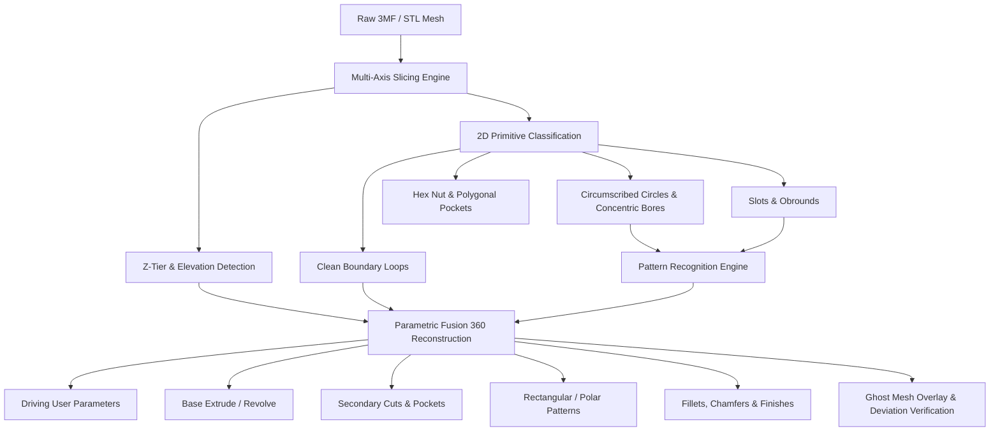

# Mesh-to-CAD Reverse-Engineering Theory & Architecture

## 1. The Fatal Flaw of "Convert Mesh to Solid" (MeshToBREP)

When users or novice agents encounter a `.stl` or `.3mf` file in Fusion 360, the tempting shortcut is to execute Fusion's built-in **"Convert Mesh"** command (`bRepBodies.addByMesh` or Mesh-to-BRep).

**This fails in production for mechanical parts:**
1. **Facet Explosion**: An STL mesh does not represent analytic surfaces (cylinders, planes, spheres); it tessellates everything into planar triangular facets. A standard M3 screw hole becomes 16 to 64 planar faces; a curved bracket becomes 50,000 tiny triangles.
2. **Timeline Paralysis**: The Fusion 360 compute engine must compute adjacency topologies across tens of thousands of triangular faces. This causes severe viewport lag, compute timeouts, and timeline bloat.
3. **Loss of CAD Modeling Operations**: You **cannot** fillet, chamfer, draft, or shell a faceted BRep body. The fillet engine requires smooth continuous edges between analytical surfaces.
4. **No Parametric Design Intent**: You cannot resize a hole from 3.0mm to 3.2mm, modify a wall thickness, or adjust mounting hole pitches. The model is a "dumb" frozen polygon shell.

---

## 2. The Analytical Reverse-Engineering Pipeline: "Slice, Dice & Synthesize"

Rather than converting mesh triangles into solid faces, expert CAD reverse-engineers treat the mesh as an **inspection artifact**. We dissect the mesh mathematically to recover the original mechanical design intent, and then author **100% native parametric timeline features**.

---

## 3. Metrology Mathematics: Tessellation Chord Error

When a CAD cylinder of radius $R$ is exported to STL or 3MF, the circular circumference is approximated by an $N$-sided inscribed polygon.

### The Inscribed Inward Bias
The vertices of the polygon lie on the true circle, but the straight chord edges cut inward:
- Minimum distance from center to chord edge:
  $$r_{\min} = R \cos\left(\frac{\pi}{N}\right)$$
- If an algorithm uses naive average radius or bounding circle on inner holes, the resulting hole will be significantly undersized. A $3.0\text{ mm}$ M3 clearance hole will print as $2.75\text{ mm}$, binding fasteners.

### True Circumscribed Circle Compensation
To recover the original engineering intent:
1. Extract all 2D polygon vertices $(x_i, y_i)$ along the hole loop.
2. Fit a least-squares circle center $(x_c, y_c)$.
3. Compute the distribution of radial distances $d_i = \sqrt{(x_i - x_c)^2 + (y_i - y_c)^2}$.
4. Use the **95th-percentile radius** $R_{95}$ rather than the mean.
5. Snap $R_{95}$ to standard engineering increments ($0.05\text{ mm}$ or $0.1\text{ mm}$).

---

## 4. Architectural Archetypes

Before generating CAD code, classify the part:

| Archetype | Characteristics | Reconstruction Strategy |
| :--- | :--- | :--- |
| **Type A: Prismatic CAD** | $\le 4$ discrete Z-tiers, planar faces, parallel walls. | Single base extrusion + pocket cuts + hole features. |
| **Type T: Turned / Lathe** | Collinear circular cross-sections along central axis. | Sketch half-profile on XZ plane + 360° RevolveFeature. |
| **Type B: Enclosure / Shell** | $5 - 15$ tiers, thin walls, ribs, mounting standoffs. | Multi-plane construction planes + step extrusions + shell. |
| **Type C: Organic Mesh** | High non-planar curvature, $> 20$ non-stepped tiers. | Inform user: planar CAD conversion will staircase. Requires T-Spline / SubD form. |

---

## 5. Ghost Reference Overlay Validation & Clean Handover

To guarantee 1:1 mathematical fidelity without keeping faceted bodies in the final design:
1. Extract ground-truth STL meshes from the 3MF archive first using `inspect_3mf.py` and import into a temporary reference staging occurrence: `Reference_Meshes_Staging`.
2. Set appearance to semi-transparent ghost overlay on the component: `ref_comp.opacity = 0.5`.
3. Build the pristine parametric BRep solid inside the main component directly aligned with the staged mesh coordinates.
4. Perform multi-perspective visual overlay inspection (`iso-top-right`, `front`, `top`, `right`): the solid body should align with the reference mesh perfectly with nominal clearances on travel stops.
5. Delete all staging occurrences across the document before production handover and assert `comp.bRepBodies.count > 0`, `comp.meshBodies.count == 0`, and document-wide zero mesh bodies (`total_doc_meshes == 0`).

---

## 6. Why Multi-Axis Cross-Sections Beat Surface Silhouettes

Camera projections and surface silhouettes only reveal exterior boundaries. When a mechanical part contains internal or recessed features, standard views fail completely:
1. **$45^\circ$ Dovetail / Knife-Edge Rails**: A top view shows only an outer rectangle and a silhouette edge; it cannot determine whether the edge is a 90° shoulder, a fillet, or a $45^\circ$ undercut. Transverse $Y$-sections and $X$-sections immediately expose the continuous triangular profile and undercut depth.
2. **Stepped Internal Margins & Pin Depths**: Depth-color mapping and $Z$-sections expose whether an area is flush with the build plate or stepped down by $1.0\text{ mm}$ to form a card retention bezel.
3. **Plateau Transition Detection**: By continuously scanning the perimeter and cross-sectional area along each primary axis, the metrology engine automatically detects exact transition points ("geometric events") where slots begin, end, or step down, eliminating manual coordinate guesswork.

---

## 7. Canonical Design-Frame Alignment (Thinnest Axis $\to Z$)

In 3D printing and 3MF packaging, slicers often arrange parts on their thin edge or skewed at arbitrary angles to pack multiple plates or optimize layer strength (e.g., plates standing vertically at $91.0\text{ mm}$ height with $4.6\text{ mm}$ thickness).
- Slicing along the physical print frame forces hundreds of redundant Z-tiers along a constant prismatic profile, misclassifying simple prismatic plates as organic sculptures (`Type C`).
- **Canonical Design-Frame Transformation**: Before metrology, the part is rotated so that:
  - Its thinnest dimension is aligned with the CAD $Z$-axis (laying plates flat).
  - Its primary functional length is aligned with the $Y$-axis.
  - The base is set at $Z = 0$, centered at $(0, 0)$.
This transforms the CAD reconstruction into standard, intuitive sketching planes ($XY$ for base outlines, $XZ$ or $YZ$ for longitudinal profiles).

---

## 8. Quantitative Slice-by-Slice Diff (IoU & XOR Area) vs. Visual Guesswork

Visual ghost overlays can mask small errors, such as missing pins or a slot that is $1.0\text{ mm}$ too short. The quantitative section-diff engine (`section_pack.py diff`) guarantees mathematical fidelity:
1. Both the reference ground-truth mesh and the exported parametric solid are sliced across identical $X, Y, Z$ planes at plateau transition points.
2. For each slice, the 2D polygon Boolean symmetric difference ($\text{XOR} = (A \cup B) \setminus (A \cap B)$) and Intersection-over-Union ($\text{IoU} = (A \cap B) / (A \cup B)$) are calculated.
3. Slices failing the strict tolerance gates ($\text{IoU} < 0.97$ or $\text{XOR} > 6.0\text{ mm}^2$) generate dual-color visual error sheets:
   - **Red**: Material present in ground truth but missing in the CAD model.
   - **Blue**: Extra material present in the CAD model that overshoots ground truth.
A part is only signed off when all slices pass tolerance.
