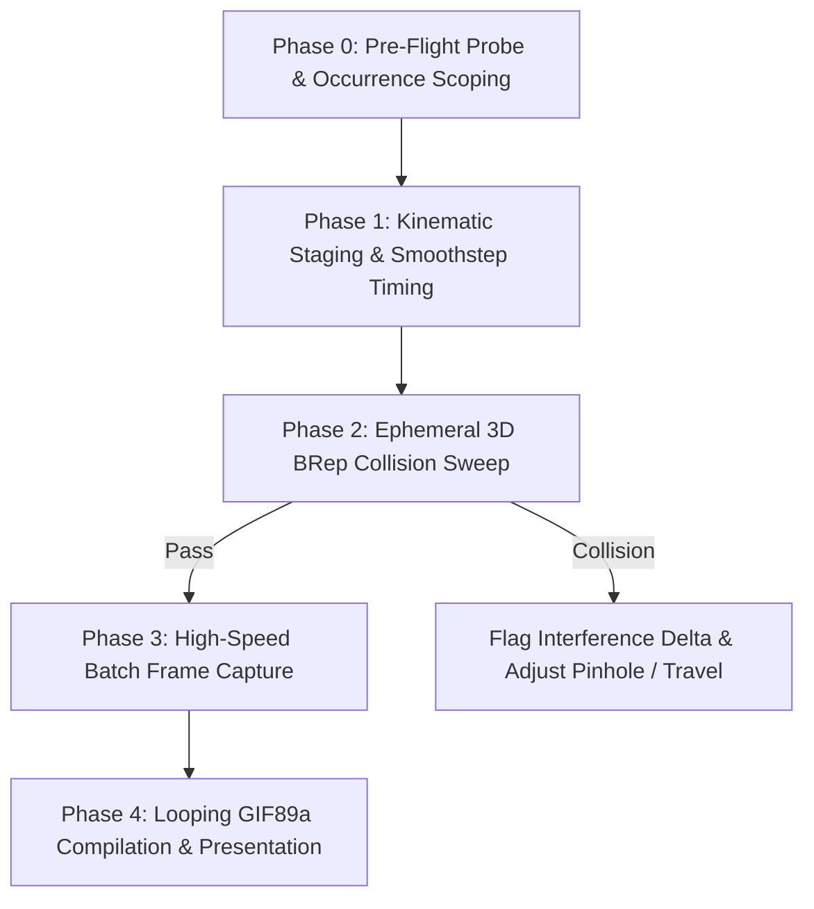

# To-Fusion Animate: High-Speed Assembly Animation & Kinematic Collision Pipeline

Use this skill when the user requests an animation, exploded view simulation, kinematic mechanism motion study, or dynamic collision verification for a model created via `3mf-to-fusion`, `media-to-fusion`, `text-to-fusion`, or manual CAD modeling.

---

## ⚡ Strict Engineering Mandates

1. **Zero Timeline Bloat Mandate:** Never call `component.features.moveFeatures.add()` inside animation loops. Recomputing timeline features takes $\sim 2.2\text{ s/frame}$ and clutters the document history. Always assign 4x4 affine matrices directly to `Occurrence.transform` ($0.005\text{ s/update}$).
2. **Viewport Halo Ban:** Always call `ui.activeSelections.clear()` before rendering viewport frames to eliminate bright cyan selection halos and planar grid artifacts.
3. **Ephemeral Collision Staging:** Run multi-frame dynamic collision verification inside an isolated, temporary occurrence (`Kinematic_Stage`). Filter out coincident touching faces ($V > 3.0\text{ mm}^3$) and delete the stage completely post-check.
4. **Dual-Path GIF Compilation:** Compile looping GIF89a animations using `shared.scene_animator.compile_ping_pong_gif` (Pillow Lanczos/Floyd-Steinberg quantization) with automatic fallback to `compile_ping_pong_gif_powershell` on vanilla Windows systems without Python dependencies.

---

## 🛠️ The 5-Phase Animation Workflow



---

### Phase 0: Pre-Flight Probe & Occurrence Scoping

1. **Verify Live Fusion Session:**
   Execute canary probe via `execute_api_script`:
   ```python
   def run(context):
       import adsk.core, adsk.fusion
       app = adsk.core.Application.get()
       design = adsk.fusion.Design.cast(app.activeProduct)
       if not design:
           raise RuntimeError("No active Fusion 360 design document.")
   ```
2. **Scope Moving Components:**
   Ensure each animated element or subassembly resides in its own top-level or child `Occurrence` (e.g., `Chassis`, `Link_Bar_01`, `Tray_Tier2`, `Fasteners`). If bodies are currently loose in root, wrap them into dedicated occurrences before animating.

---

### Phase 1: Kinematic Staging & Smoothstep Timing

Define normalized time parameter $s \in [0.0, 1.0]$ with `smoothstep(edge0, edge1, s)` easing:
```python
def smoothstep(edge0, edge1, x):
    t = max(0.0, min(1.0, (x - edge0) / (edge1 - edge0)))
    return t * t * (3.0 - 2.0 * t)
```

1. **Planar Mechanisms (Linkages, Hinges, Cantilevers):**
   Use `make_yz_transform(y0_mm, z0_mm, dy_mm, dz_mm, ang_rad)` from `shared.scene_animator`:
   - Computes rotation around $(y_0, z_0)$ by angle $\theta(s)$ plus linear travel $(\Delta y, \Delta z)$.
   - Converts millimeters to centimeters for the Fusion API.
2. **Exploded Assemblies:**
   Assign linear explosion vectors $\vec{v}_{\text{explode}} = (dx, dy, dz)$ scaled by stage easing $s_i = \text{smoothstep}(t_{\text{start}}, t_{\text{end}}, s)$.

---

### Phase 2: Ephemeral 3D BRep Collision Sweep

Before rendering final frames, evaluate dynamic clearance across intermediate fractions $s \in \{0.00, 0.25, 0.50, 0.75, 1.00\}$:
```python
from shared.scene_animator import check_stage_interference

# 1. Create temporary occurrence
stage = root.occurrences.addNewComponent(adsk.core.Matrix3D.create())
stage.component.name = "Kinematic_Stage"

# 2. Duplicate moving bodies into stage sub-occurrences and transform
# ...
collisions = check_stage_interference(design, groups_dict, s_val=s, min_vol_mm3=3.0)

# 3. Always clean up stage
stage.deleteMe()
```
If collisions occur ($V > 3.0\text{ mm}^3$), halt and report the colliding bodies and interference volume.

---

### Phase 3: High-Speed Batch Frame Capture

Render frames directly inside a single Fusion 360 script execution (`~0.08 s/frame`):
```python
app = adsk.core.Application.get()
vp = app.activeViewport
ui = app.userInterface
if ui:
    ui.activeSelections.clear()

os.makedirs(frames_dir, exist_ok=True)
for i in range(num_frames):
    s = i / float(num_frames - 1)
    # Apply occ.transform for each moving occurrence
    vp.refresh()
    vp.saveAsImageFile(os.path.join(frames_dir, f"frame_{i:03d}.png"), width, height)
```

---

### Phase 4: Looping GIF89a Compilation & Presentation

Compile rendered frames into an optimized ping-pong loop:
```python
from shared.scene_animator import compile_ping_pong_gif

gif_path = compile_ping_pong_gif(
    frames_dir=frames_dir,
    output_gif_path=output_path,
    num_frames=28,
    hold_assembled=25, # ~1.2s pause on assembled state
    hold_exploded=18,  # ~0.9s pause on exploded state
    frame_ms=45,
    hold_ms=50
)
```

CLI shortcut:
```bash
python3 skills/to-fusion-animate/scripts/animate_assembly.py \
    --frames-dir models/01_Sample/workspace/frames \
    --output models/01_Sample/assets/renders/assembly_animation.gif \
    --num-frames 28
```

Present the resulting `.gif` directly to the user with viewport orientation and key motion metrics.
